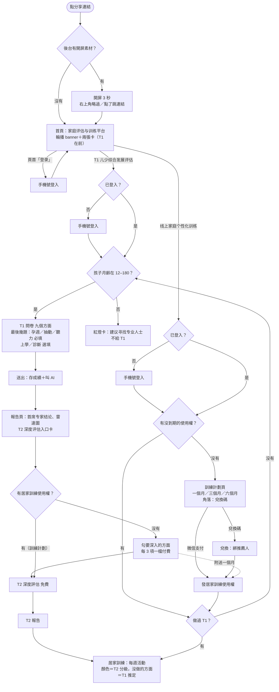
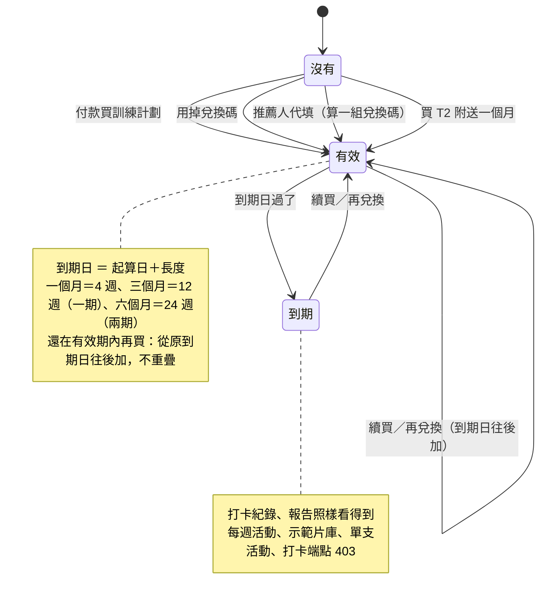
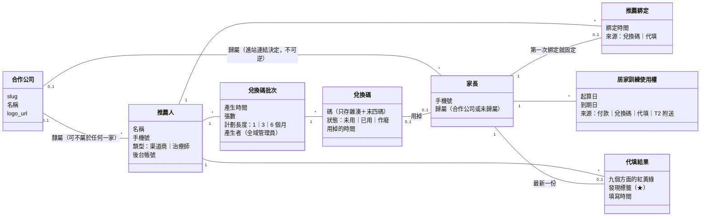
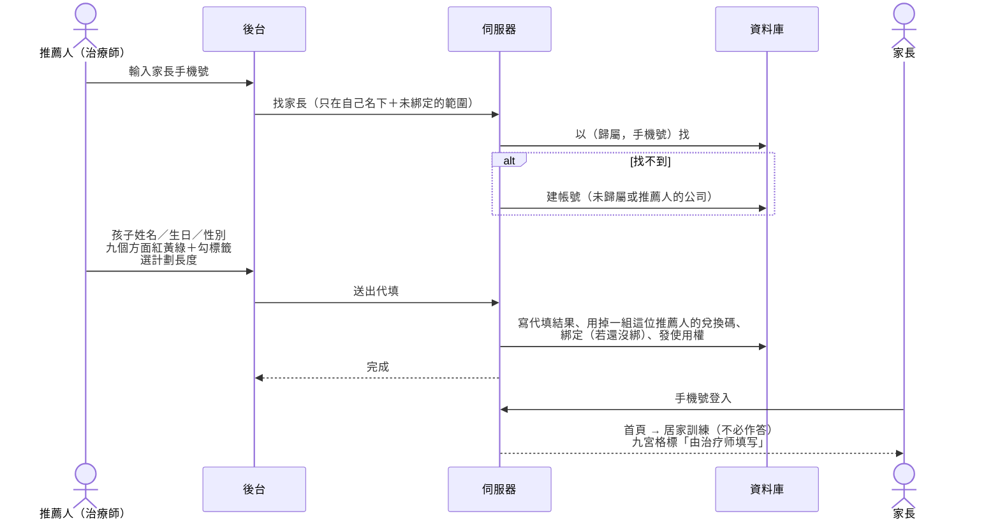
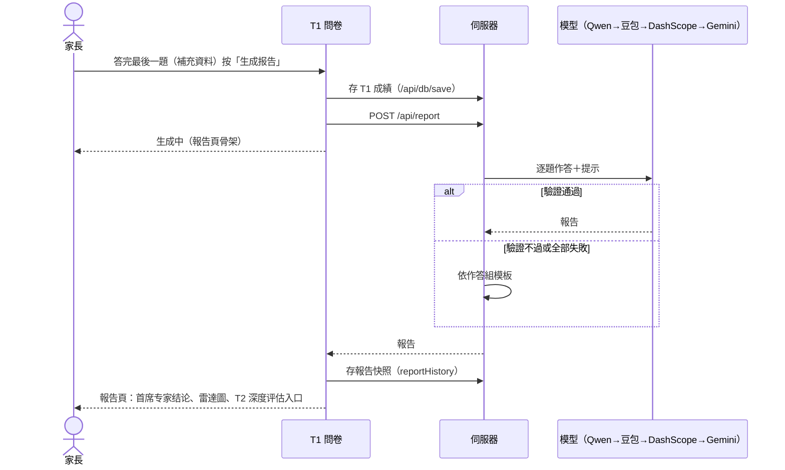
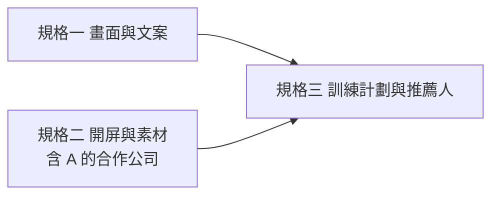

# 客戶 10/22 修改意見：UML 圖（寫規格前的共識）

來源：《修改意见20261022.pptx》（17 頁）、三份會議紀要、會議 4 逐字稿（2026-10-22）。
已定的詞與決定在 `CONTEXT.md`、`docs/adr/0013-*`、`docs/adr/0014-*`。這份只畫圖，不是規格；規格由 `/to-spec` 依此拆成三份：

| 規格 | 範圍 |
|---|---|
| 一、畫面與文案 | 簡報 17 頁＋會議 2：改名、刪字、導覽列、評估面板、交卷即生成報告（ADR-0014）、年齡範圍與補充資料、返回鍵 |
| 二、開屏與素材 | 開屏頁、首頁輪播（後台可換）、專案 A 的合作公司與 Logo |
| 三、訓練計劃與推薦人 | 訓練計劃（1／3／6 個月）、兌換碼、推薦人、代填、居家訓練使用權（ADR-0013） |

全部只在專案 A；B 一行不動。每份各一個開關、預設關。

---

## 1. 家長從進站到看影片（活動圖）

兩條購買路並存（ADR-0013）。虛線框是「現在已有、這次只改字」的部分。

要點：
- 「報告頁」不再有生成前的空殼，也沒有「T1 結論頁」（ADR-0014）。交卷到看到報告中間只有「生成中」。
- 訓練計劃那條路做完 T1 就能看影片（T1 推定）；T2 是讓下一期更準，不是必要。
- 代填的家長不走 T1，見第 4 張圖。

## 1b. 與簡報的出入（逐頁對過，2026-10-22）

簡報截圖是 **master 上的 Ledo 版**（`VITE_UI_LEDO`，10/21 合併），規格與實作都以 master 為底。

| 頁 | 簡報說 | 這裡怎麼做 | 為什麼 |
|---|---|---|---|
| 3 | 頁尾「2026**森心康**家庭评估与训练平台」 | 「© 2026 家庭评估与训练平台」 | 第 6 頁沒有森心康；逐字稿 Aaron：「全部都不要提到森心康」 |
| 3 | 「登录注册完跳转首页」 | 頁首登入完回首頁；點卡片登入完到那張卡的去處（現行 `HOME_V2`） | 簡報只標在頁首的按鈕上 |
| 3 | 「登录」「注册」兩顆 | 合成一顆「登录／注册」 | 逐字稿：兩顆本來就到同一頁 |
| 3 | 卡片「调换顺序」 | T1 在前、居家訓練在後；線下服務點拿掉 | — |
| 3 | 卡片「线上家庭个性化训练」點進去 | 規格三的開關開著：沒有使用權到訓練計劃頁；關著：照現在到居家訓練頁 | 逐字稿：點進去先看到一個月／三個月／六個月 |
| 4 | 登入後首頁「待定」 | 只改名，版面不動 | 客戶還沒定 |
| 8、10 | 商城「先不开放」 | 導覽列與個人中心的商城、商城訂單藏在開關後面，預設關 | 逐字稿 4-3：「先关掉…后台要启动再启动，有这样的开关」 |
| 11、12 | T1 結論頁要改標題、免責句、小結，底下按鈕要跳色、改「T2 深度评估」 | **整頁拿掉**（ADR-0014）；免責句、叫法搬到報告頁；跳色加在報告頁的 **T2 深度评估入口卡** | 使用者 10/22：「填完问卷就直接生成 AI」 |
| 13、14 | 生成前報告頁的「先看这几项」刪除 | 生成前的報告頁整頁不存在了 | ADR-0014 |
| 16 | 報告最上面的「先看这几项」（`LedoReportSummary`）刪除 | 刪；家長端與掃碼頁都不畫 | — |
| 16 | （使用者另外指定）各方面那段 | 「接下来可以多练的」每個方面只留「这次看到的是……」＋練法；拿掉「这一项 4 题里……」那句統計與「还不能／有时」逐題清單（模板與模型兩條路） | 使用者 10/22 |
| 17 | 「9 维度评估结果明细」拿掉，留雷達圖 | 照做；「第二层『量表评估中心』」改「T2 深度评估」 | 會議 2「取消雷達圖」指的是評估面板，評估面板改三欄 |
| 17 | 首席專家建議「简易逻辑」 | 提示詞與模板改成三句：整體、優先、下一步；用對照腳本產樣本給 Aaron | 會議 2 待辦派給 Aaron |

## 2. 居家訓練使用權（狀態圖）

取代 ADR-0012 的「先 T2、再線上干預收費站」兩道閘門。

## 3. 推薦人、兌換碼與家長（類別圖）

要點：
- **歸屬**（合作公司）與**推薦綁定**（推薦人）是兩件事：一位家長可以從醫院 A 的連結進來（歸屬醫院 A），用的是渠道商 B 的兌換碼（綁推薦人 B）。
- 家長已經綁了推薦人，再用另一位推薦人的兌換碼：照樣拿到使用權，**綁定不變**；這一組碼的佣金歸誰由對帳表看「碼屬於誰」，不看綁定。
- 兌換碼只存雜湊（與 `handoff_codes` 同一套做法），後台產生的當下顯示一次、可匯出。

## 4. 推薦人代填（序列圖）

## 5. 交卷即生成報告（序列圖，ADR-0014）

注意：`/api/report` 掛在 `aiLimiter` 之下。以前要按兩次才叫 AI，現在每次交卷都叫，限流的額度要在規格裡重新看。

## 6. 規格之間的相依

規格三的「推薦人隸屬合作公司」要等規格二在 A 開了合作公司；規格三的訓練計劃頁與首頁卡片的去向要等規格一改完首頁。規格一與規格二可以平行。
